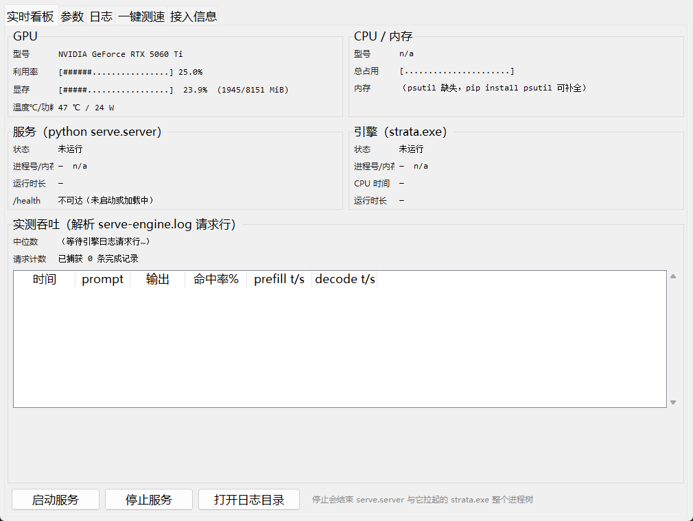
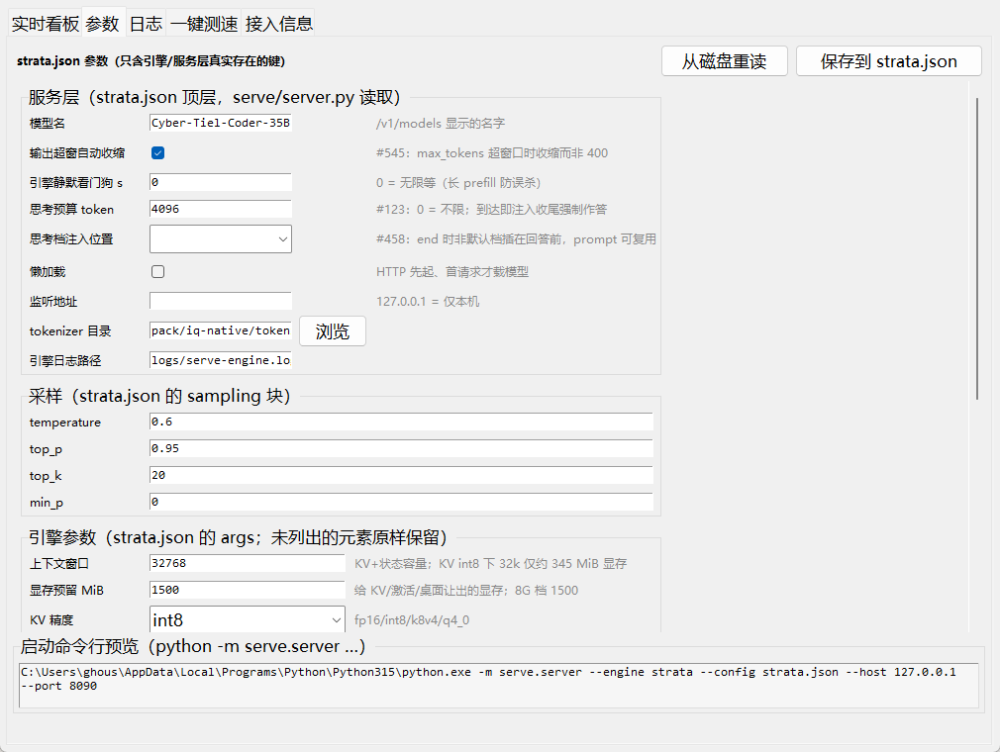
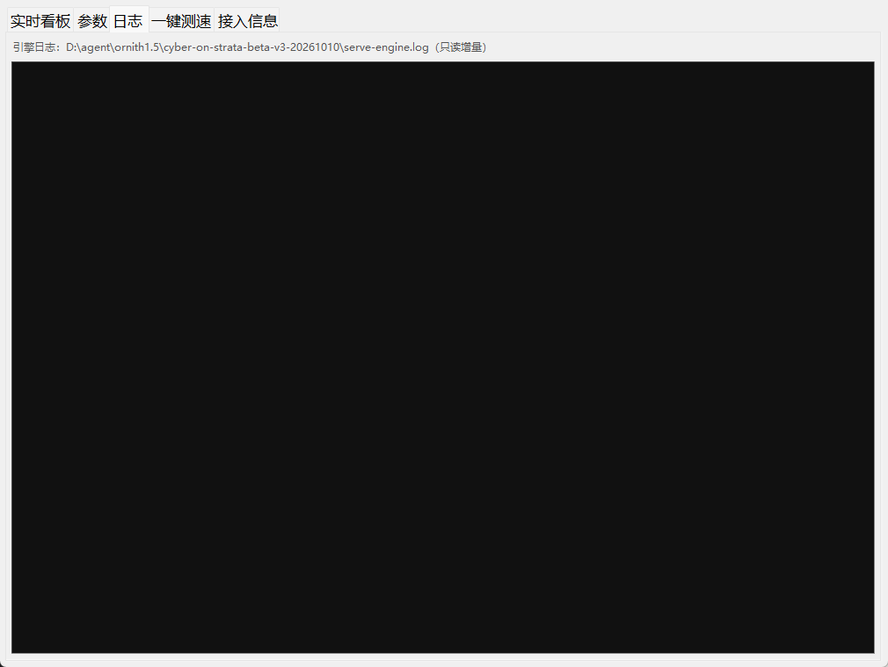
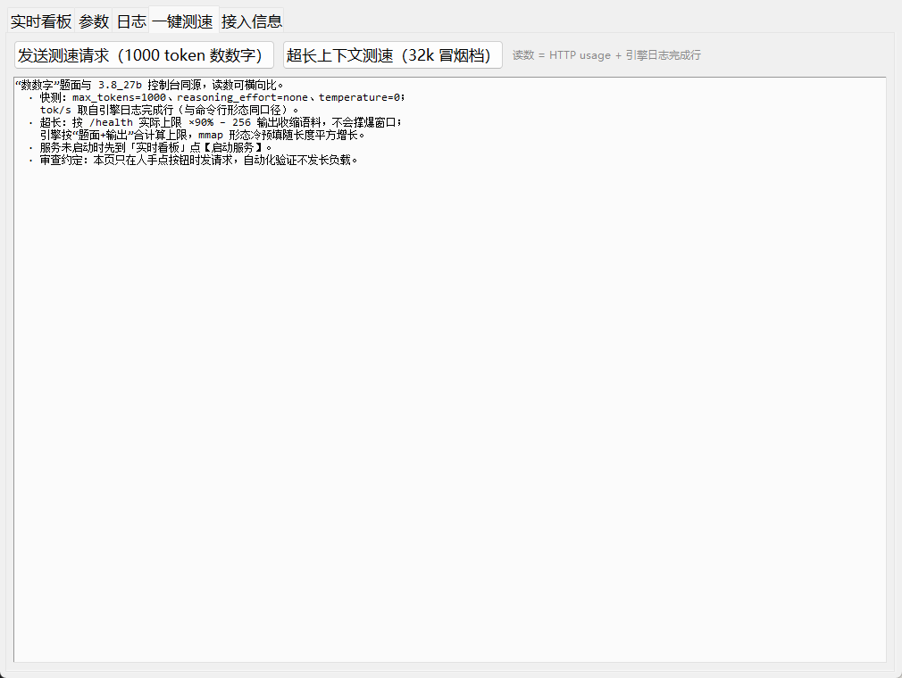
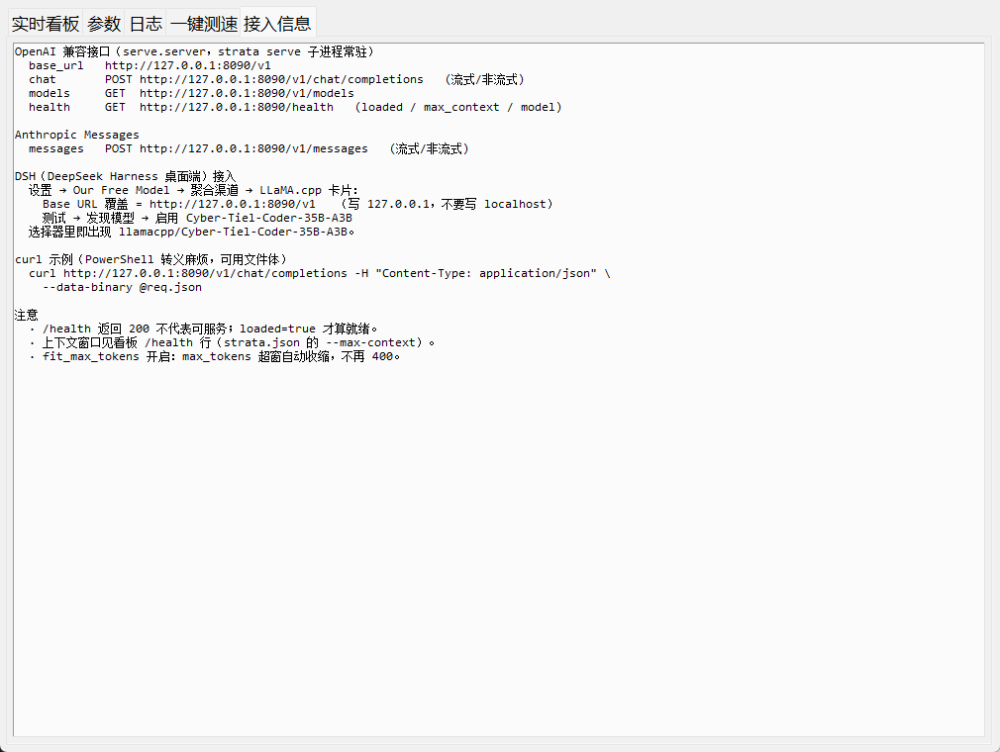

# Cyber-Tiel-35B on Strata · RTX 5060 Ti 8GB 部署全记录

在 **RTX 5060 Ti 8GB + 32GB 内存**的桌面机上，把 **Cyber-Tiel-Coder-35B-A3B**（35B 总参 / 3B 激活的 MoE，Q4_K_XL，21.2 GiB）跑成 **OpenAI 兼容本地 API**，接入 DeepSeek Harness（DSH）做 agent 日常使用。本文记录真实配置、调参依据、控制台界面与一次完整的**鹈鹕骑车 SVG 基准测试**。

## 致谢

本包的引擎、专家 pack 与调参体系全部来自 B 站 UP 主 **沈三殊** 的方案，在此致谢：

> **【moe小专武：小显存部署新方案！】**
> https://www.bilibili.com/video/BV1h8WA6XEFQ

- 引擎：[cyber-on-strata](https://github.com/1314521gjy/cyber-on-strata)（Strata fork，MIT）
- 模型：[peculiar-ragdoll/Cyber-Tiel-Coder-35B-A3B-GGUF-MTP](https://huggingface.co/peculiar-ragdoll/Cyber-Tiel-Coder-35B-A3B-GGUF-MTP)（MIT；魔搭同名仓库可直下）
- 原包文档见 [docs/先读我.md](docs/先读我.md) 与 [docs/发货参数与显卡分档调优-20261010.md](docs/发货参数与显卡分档调优-20261010.md)（调参出问题先查后者）

## 硬件

| 项 | 配置 |
|---|---|
| GPU | NVIDIA GeForce RTX 5060 Ti 8GB（Blackwell，sm_120） |
| 内存 | 31.6 GB（贴着原包"≥32 GB"的下限） |
| 模型盘 | 外接 USB SSD（三星 T7 Shield）；换内置 NVMe 可再提速 |
| 系统 | Windows 11 · Python 3.15 · CUDA 13 运行时（包内自带 DLL） |

## 调参（strata.json 核心项与依据）

| 参数 | 值 | 为什么 |
|---|---|---|
| `--max-context` | **32768**（默认 4096） | 8G 显存的瓶颈不是 KV：int8 下 32k 仅 ~345 MiB（4k 才 86 MiB），真正吃显存的是常驻权重+激活。DSH 的 agent prompt 实测会涨到 19k–26k token，4096 物理装不下 |
| `--resident-experts` | 开 | **31.6G 内存的正确姿势**。默认形态要钉 19.68G 宿主银行，本机可用内存不够（v3 自动保护把钉住压到 ~18.6G），实测两次在加载 ~243s 时崩溃；resident-experts = mmap + CPU 池页锁定，加载后 16.79G 专家驻留内存、文件读取 0 次，稳定 |
| `fit_max_tokens` | true | DSH 每次请求 max_tokens=32768，超窗自动收缩到剩余空间而不是 400 拒绝 |
| `engine_silence_s` | 0 | 服务看门狗默认 300s 收不到引擎输出就杀请求；长 prefill/磁盘抖动时是误杀，关掉 |
| `reasoning_budget_tokens` | 4096 | 模型思考链默认 xhigh 档，无预算时实测一路思考 20+ 分钟、烧掉 ~1.7 万 token 输出直到被 DSH 截断；4096（约 4 分钟）强制收敛，续写不受影响 |
| `--expert-profile-save` | serve-learned.bin，每 10 分钟 | 预填表从作者的 trace 档案逐步换成**本机真实路由**：命中率 28.8% → 48.2% → 54.6% 爬坡 |
| `--kv` | int8 | 精度/显存平衡点（8G 档默认） |
| `--vram-reserve-mib` / `--prefill` | 1500 / 2048 | 8G 档默认，未动 |
| `sampling` | temperature 0.6 · top_p 0.95 · top_k 20 · min_p 0 | 作者指定的 API 采样档（与命令行的贪心不同） |

## 设置与启动

```powershell
# 1) 模型（约 21.2 GiB，只下 UD-Q4_K_XL 这个量化）
pip install -U modelscope
modelscope download --model peculiar-ragdoll/Cyber-Tiel-Coder-35B-A3B-GGUF-MTP Cyber-Tiel-Coder-35B-A3B-MTP-UD-Q4_K_XL.gguf --local_dir <包>\models

# 2) 依赖（HTTP 层仅此两个第三方包）
pip install jinja2 regex psutil pillow

# 3) 启动（二选一）
<包>\serve.cmd            :: 命令行形态
<包>\strata控制台.bat      :: 图形控制台（看板/参数/日志/测速）
```

服务就绪判据：`GET http://127.0.0.1:8090/health` 返回 `"loaded": true`（冷启动 5–8 分钟，页缓存热时 ~2 分钟）。

**DSH 接入**：设置 → Our Free Model → 聚合渠道 → LLaMA.cpp 卡片，Base URL 覆盖为 `http://127.0.0.1:8090/v1`（写 127.0.0.1 别写 localhost），发现模型后选 `llamacpp/Cyber-Tiel-Coder-35B-A3B`。

## 控制台界面

双击 `strata控制台.bat`。关闭控制台不影响已启动的服务（独立进程）。

| 实时看板 | 参数 |
|---|---|
|  |  |

| 日志 | 一键测速 | 接入信息 |
|---|---|---|
|  |  |  |

- 看板：GPU/CPU/内存、服务与引擎进程、/health、实测吞吐（解析引擎日志的请求行）
- 参数：`strata.json` 表单化，只收录引擎/服务层真实存在的键，保存前校验
- 测速：1000 token"数数字"快测 + 超长上下文测速（按实际上限 90% 自动收缩），读数与 3.8_27b 控制台同口径

## 鹈鹕骑车 SVG 基准测试

提示词（与社区基准一致）：

> 生成一只骑自行车的鹈鹕的动画SVG。使用\<animateTransform\>实现车轮旋转和腿部蹬踏效果。鹈鹕需呈现真实鹈鹕特征，自行车需符合自行车形态。仅输出完整SVG代码。

**实测过程**（数字取自 `logs/serve-engine.log`，DSH agent 形态）：

| 轮次 | prompt | 输出 | 读数 |
|---|---|---|---|
| 首轮（工具多轮调用，prompt 随会话 16k→21k 爬升） | 19,211–21,210 tok | 74–813 tok/轮 | prefill **810–857 tok/s**，decode **22–26 tok/s**，命中率 38–55% |
| 思考失控轮（xhigh 无预算） | 6,114 tok | 累计 ~1.7 万 tok | 思考 20+ 分钟直至吃满输出上限，被 DSH 截断（"发送继续可接着输出"） |
| **"继续"续写轮（终局）** | **26,064 tok** | **4,399 tok @ 25.8 tok/s（170.7 s）** | 完成，产出 `logs/pelican_bicycle.svg`（8 KB） |

**产物验收**（[logs/pelican_bicycle.svg](logs/pelican_bicycle.svg)）：

- ✅ `<animateTransform>` 共 **6 处**：车轮 `rotate` 旋转、腿部蹬踏 `rotate` + 身体 `translate` 补偿
- ✅ 鹈鹕真实特征结构齐全：`billF`（喙）、`pouchF`（喉囊）、`wingF`（翅）、`legF`（腿）、`bodyF`
- ✅ 天空/身体渐变着色，800×600 完整画幅，代码一次成型

**思考要素**：思考链为模板默认 **xhigh** 档（low/medium/xhigh 三档的最高档）；首轮无预算的教训固化成了 `reasoning_budget_tokens: 4096`（约 4 分钟强制收敛）。

## 已知边界（如实）

- 8G 卡在 strata 上：不支持 MTP 加速、视觉被阉割、decode 速度受宿主内存带宽限制（本机 22–26 tok/s）
- 内存是硬前提：31.6G 贴线可用（resident-experts 形态），<32G 建议直接用它；想回默认钉住形态请上 48G+ 内存
- 模型为去审查（abliterated）版本：**仅限本地受控环境使用**，勿发送敏感内容
- 引擎/模型二进制不随本仓库分发（体积），获取方式见「致谢」与原包文档

## 目录

见 [INDEX.md](INDEX.md)。原包说明见 [docs/README-原包.md](docs/README-原包.md)。

## 许可

MIT（引擎与派生制品），模型权重 MIT。本仓库的部署配置与文档按原样提供，不含任何担保。
